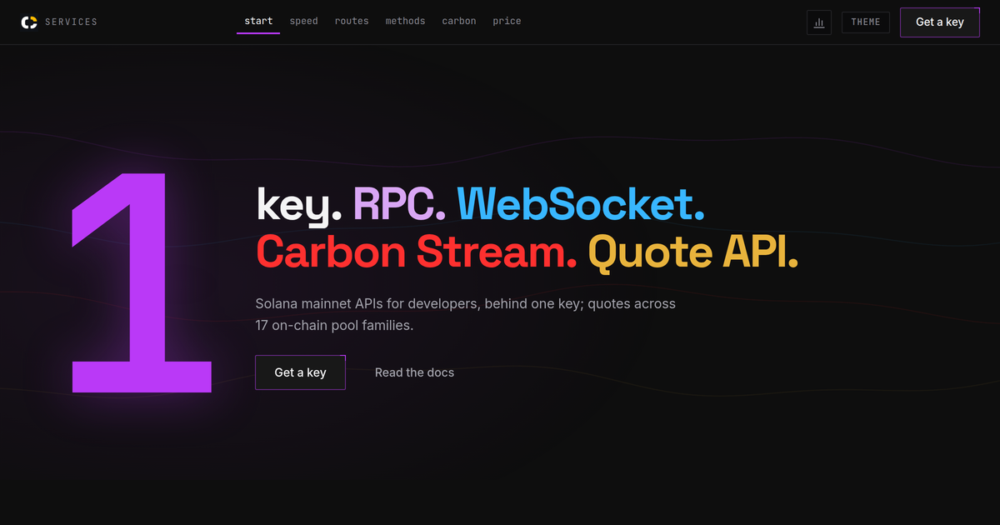

<div align="center">



# Carbium

<h1 align="center">Solana APIs behind one key</h1>
<h2 align="center">RPC, WebSocket, Carbon Stream and a quote API for developers</h2>

<p align="center">
  
  
  
  
  
  
  
</p>

<p align="center">
  <a href="https://carbium.sh"></a>
  <a href="https://carbium.sh/docs"></a>
  <a href="https://carbium.sh/skill.md"></a>
  <a href="https://carbium.sh/llms.txt"></a>
  <a href="https://carbium.sh/openapi.json"></a>
</p>

</div>

## Introduction

Carbium gives developers API access to Solana mainnet behind one key: JSON-RPC, WebSocket subscriptions, a
Yellowstone gRPC stream and a quote API that returns prices and unsigned transactions for your app to sign.
Plans are monthly and you can start on the free one.

## Services

| | |
|---|---|
| RPC | JSON-RPC 2.0 over HTTPS at `https://services.carbium.sh`, with the DAS methods on the same endpoint. |
| WebSocket | JSON-RPC subscriptions for accounts, programs, logs, signatures, slots and blocks at `wss://services.carbium.sh`. |
| Carbon Stream | Yellowstone gRPC at `https://services.carbium.sh:9443`, on the DEV, BUSINESS and PRO plans. It works with the standard Yellowstone clients. |
| Quote API | `quote`, `swap`, `prices` and `health` on the RPC endpoint. A swap comes back as an unsigned transaction that your own wallet signs. |
| Webhooks | A signed HTTPS POST for each finalized transaction that touches an address you list, on the DEV, BUSINESS and PRO plans. |
| Account API | Keys, webhooks and usage managed by API with an account key, described in [openapi.json](https://carbium.sh/openapi.json). |

### First call

```bash
curl -s https://services.carbium.sh \
  -H 'content-type: application/json' -H "x-api-key: $CARBIUM_KEY" \
  -d '{"jsonrpc":"2.0","id":1,"method":"getSlot"}'
```

Get a key at [carbium.sh](https://carbium.sh). The [docs](https://carbium.sh/docs) list every method with its limits and errors.

## For AI agents

[skill.md](https://carbium.sh/skill.md) is the whole API as one markdown skill for a coding agent, and
[llms.txt](https://carbium.sh/llms.txt) is the short index. An agent that holds a Solana keypair can sign up and
read its API key over HTTPS, with no browser and no inbox. Plans and prices are served as JSON at
[carbium.sh/v1/plans](https://carbium.sh/v1/plans).

## Our code

Our SDKs, CLI and agent tools are published in this organisation as they are released.

## Contact

[carbium.sh](https://carbium.sh) · [Docs](https://carbium.sh/docs) · support@carbium.sh

<p align="center">© 2026 Carbium</p>
